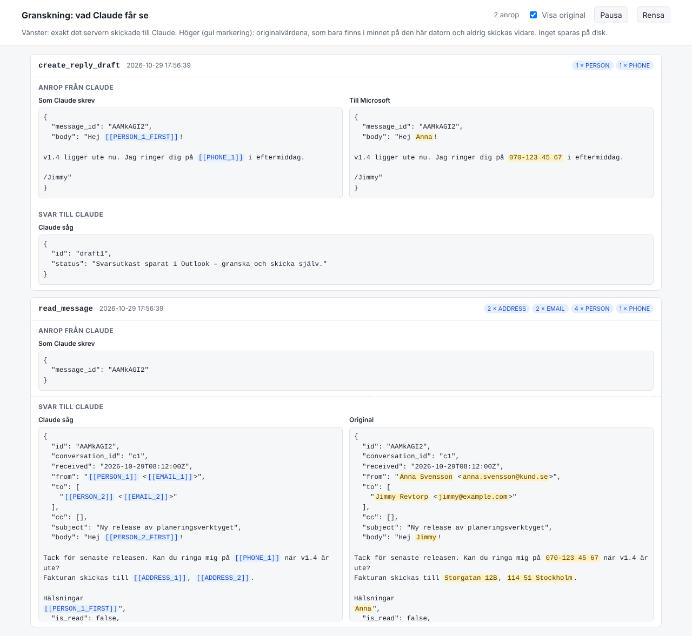

# m365-mcp-gdpr

MCP-server som ger Claude åtkomst till Microsoft 365 – Outlook, kalender, Teams och en
SharePoint-mapp för releaser – via Microsoft Graph, **med pseudonymisering av
personuppgifter innan något lämnar er maskin**.

Det är samma data som Microsoft 365 Copilot arbetar mot. Copilot har inget eget API
för att läsa/skriva mejl, så servern pratar direkt med Microsoft Graph.

## Vad den kan

Servern är uppdelad i delar som slås på var för sig med `M365_MCP_FEATURES`
(se [Välja delar](#välja-delar-av-microsoft-365)). Som standard är bara `sharepoint` påslagen.

| Del | Verktyg | Beskrivning |
|---|---|---|
| `mail` | `list_folders` | Mappar med antal (olästa) |
| `mail` | `list_messages` | Lista mejl i en mapp, filtrera på olästa |
| `mail` | `search_messages` | Fritextsök i hela brevlådan |
| `mail` | `read_message` | Läs ett mejl (bilagors innehåll hämtas inte) |
| `mail` | `mark_read`, `flag_message`, `set_categories`, `move_message` | Administrera |
| `mail` | `create_draft`, `create_reply_draft`, `update_draft`, `delete_draft` | Utkast |
| `calendar` | `calendar_list_events`, `calendar_get_event` | Läs kalendern för en period, eller en händelse med beskrivning |
| `calendar` | `calendar_create_event` | Boka tid i din egen kalender (t.ex. fokustid) – aldrig med deltagare |
| `calendar` | `calendar_delete_event` | Ta bort egen händelse utan deltagare |
| `teams` | `teams_list_chats`, `teams_read_chat` | Lista chattar och läs meddelanden |
| `teams` | `teams_list_teams`, `teams_list_channels`, `teams_read_channel` | Lista team och kanaler, läs inlägg |
| `sharepoint` | `sharepoint_upload_release` | Ladda upp en lokal fil (t.ex. release-zip) till en förbestämd SharePoint-mapp |
| `sharepoint` | `sharepoint_list_releases` | Lista filer i release-mappen, med länkar |

Valfritt: en lokal [granskningssida](#granskningssida-valfri) som visar exakt vad Claude får.

**Servern skickar aldrig något till andra personer.** Allt som når någon annan granskas
och skickas av en människa:

- **Mejl:** bara utkast. Servern begär aldrig `Mail.Send`, så den saknar behörighet att
  skicka. `delete_draft` vägrar radera något som inte är ett utkast.
- **Kalender:** bara tid i din egen kalender. Möten med deltagare skapas inte (det skickar
  inbjudningar), och möten med deltagare raderas inte (det skickar avbokningar).
- **Teams:** bara läsning. Teams har inga utkast, så servern begär ingen skrivbehörighet.

Namn, deltagare, platser och meddelandetext i mejl, kalender och Teams tvättas på
samma sätt innan de når Claude.

## Hur GDPR-tvätten fungerar

```
Outlook ──Graph──▶ [ MCP-server: redact() ] ──tokens──▶ Claude
Outlook ◀─Graph─── [ MCP-server: restore() ] ◀─tokens── Claude
                        │
                   Vault (endast RAM)
```

1. När ett mejl hämtas lär sig servern namn och adresser ur avsändare/mottagare.
2. Ämne, förhandsvisning, brödtext, bilagenamn och adresser tvättas. Ersätts med
   stabila tokens:

   ```
   Hej [[PERSON_1_FIRST]]! Mitt personnummer är 18830702-6115, ring
   [[PHONE_1]]. Adress: [[ADDRESS_1]]. /[[PERSON_2]] [[EMAIL_3]]
   ```
3. Kopplingen token → riktigt värde finns **bara i serverprocessens minne** och
   skickas aldrig till modellen. Den försvinner när servern stängs.
4. När Claude skriver ett utkast med tokens byts de tillbaka till riktiga
   värden innan utkastet sparas i Outlook. Okända tokens avvisas.

**Detekteras:** e-postadresser, telefonnummer (svenska + internationella), IBAN,
kortnummer (Luhn), IP-adresser, svenska gatuadresser och postnummer+ort, samt
personnamn från mejlhuvuden, e-postadresser (`fornamn.efternamn@`) och en valfri
namnlista. Med `REDACT_USE_NER=1` används även spaCys svenska NER-modell för namn i fritext.

**Personnummer** från Sverige (även samordningsnummer), Danmark (CPR), Norge
(fødselsnummer, D-nummer) och Finland (henkilötunnus) ersätts inte med en token utan
med ett **påhittat nummer i samma format, med födelseår på 1800-talet**, t.ex.
`18830702-6115`. Ingen levande person kan ha det, och där formatet har kontrollsiffra
är den giltig. Svenska nummer med bindestreck fångas även om kontrollsiffran är fel
(felskrivna nummer är fortfarande personuppgifter). Tio siffror utan bindestreck kräver
rätt kontrollsiffra, så att vanliga order- och telefonnummer inte tvättas i onödan.
Fejknumret byts tillbaka till det riktiga om Claude använder det i ett utkast.

### Begränsningar – läs detta

- Regelbaserad tvätt är aldrig 100 %. Namn i fritext på personer som inte
  förekommer i mejlhuvuden fångas bara med NER eller namnlista. Hälsodata,
  fackmedlemskap och andra känsliga uppgifter (art. 9) i fritext fångas inte.
- Pseudonymiserade uppgifter är fortfarande personuppgifter enligt GDPR
  (art. 4.5, skäl 26). Tvätten är en skyddsåtgärd (dataminimering, art. 25 och 32)
  – den ersätter inte rättslig grund, personuppgiftsbiträdesavtal (DPA) med
  Anthropic, registerförteckning eller eventuell DPIA.
- Mejl-ID:n och datum skickas otvättade (de är inte personuppgifter i sig).

## Installation

### 1. App-registrering i Microsoft Entra ID

1. Entra admin center → *App registrations* → *New registration*.
2. *Supported account types*: Endast den här organisationen.
3. *Authentication* → *Add a platform* → **Mobile and desktop applications**, lägg till:
   - `http://localhost` (inloggning via webbläsare)
   - `ms-appx-web://Microsoft.AAD.BrokerPlugin/<client-id>` (Windows inbyggda kontoruta)
   - `msauth.com.msauth.unsignedapp://auth` (Mac med Company Portal)
4. *Authentication* → *Allow public client flows* = **Yes** (behövs bara för `--device-code`).
5. *API permissions* → Microsoft Graph → **Delegated**: `User.Read` plus behörigheten
   för varje del ni ska använda (se [Välja delar](#välja-delar-av-microsoft-365)):
   `Sites.ReadWrite.All` för `sharepoint`, `Mail.ReadWrite` för `mail`,
   `Calendars.ReadWrite` för `calendar` och `Chat.Read`, `Team.ReadBasic.All`,
   `Channel.ReadBasic.All`, `ChannelMessage.Read.All` för `teams`.
   `Sites.ReadWrite.All` och `ChannelMessage.Read.All` kräver admin consent. Behörigheterna är delegerade: servern
   kommer bara åt det du själv har behörighet till.
6. Notera *Application (client) ID* och *Directory (tenant) ID*.

### 2. Installera programmet

Kräver Python 3.11 eller senare. Installera med [pipx](https://pipx.pypa.io), så hamnar
programmet i en egen miljö och kommandot `m365-mcp-gdpr` blir tillgängligt överallt:

```bash
pipx install git+https://github.com/Lonestarrk/m365-mcp-gdpr
```

Mac med Company Portal (för inloggningsrutan i stället för webbläsaren):

```bash
pipx install "m365-mcp-gdpr[broker] @ git+https://github.com/Lonestarrk/m365-mcp-gdpr"
```

Är repot privat behöver du vara inloggad mot GitHub på datorn först, t.ex. med `gh auth login`.

### 3. Installera i Claude Code

```bash
claude mcp add m365 --scope user \
  -e M365_MCP_CLIENT_ID=<client-id> \
  -e M365_MCP_TENANT_ID=<tenant-id> \
  -e M365_MCP_LOGIN_HINT=<din jobbmejl> \
  -e M365_MCP_FEATURES=sharepoint \
  -e SHAREPOINT_SITE="matildafoodtech.sharepoint.com:/sites/<webbplats>" \
  -e SHAREPOINT_FOLDER="<mapp för releaser>" \
  -e SHAREPOINT_UPLOAD_ROOTS="<sökväg till projektets dist-mapp>" \
  -- m365-mcp-gdpr
```

- `--scope user` gör servern tillgänglig i alla dina projekt. Utan den gäller den bara
  i mappen du står i.
- På Windows (PowerShell/cmd): skriv allt på en rad utan `\`.
- SharePoint-raderna kan utelämnas om du bara ska använda mejl, och tvärtom.
  Alla inställningar finns under [Konfiguration](#konfiguration).

Starta Claude Code och kör `/mcp`. `m365` ska stå som ansluten. Första gången Claude
använder servern öppnas inloggningen (se nedan).

**Ändra inställningar:** ta bort och lägg till igen:

```bash
claude mcp remove m365 --scope user
claude mcp add m365 --scope user ...
```

**Uppdatera till senaste versionen:** `pipx upgrade m365-mcp-gdpr` och starta om Claude Code.

**Avinstallera:** `claude mcp remove m365 --scope user`, `m365-mcp-gdpr logout` och
`pipx uninstall m365-mcp-gdpr`.

### 4. Logga in

Inloggningen sker med ditt vanliga jobbkonto:

- **Windows:** systemets egen kontoruta visas, med ditt jobbkonto förvalt. Ofta behövs
  inget lösenord alls om du redan är inloggad i Windows med jobbkontot.
- **Mac:** via Company Portal om den är installerad (se steg 2), annars öppnas
  Microsofts inloggningssida i webbläsaren.
- **Linux:** Microsofts inloggningssida öppnas i webbläsaren.

Tvåfaktorsinloggning (t.ex. Microsoft Authenticator) sköts som vanligt i den rutan.

Du behöver bara logga in en gång. Inloggningen sparas krypterat i operativsystemets
nyckelring (Windows DPAPI, macOS Keychain, Linux libsecret) och förnyas tyst i
bakgrunden. Den håller så länge du använder den regelbundet – som standard upphör den
efter 90 dagar utan användning. Er IT kan ha regler (Conditional Access, "sign-in
frequency") som kräver ny inloggning oftare; det styrs av organisationen, inte av servern.

Inloggningen öppnas automatiskt första gången Claude använder servern. **På Windows
rekommenderas att logga in i förväg** i ett terminalfönster: när Claude Code startar
servern i bakgrunden kan kontorutan hamna bakom andra fönster. Efter första
inloggningen sker allt tyst. Kör i en terminal (macOS/Linux):

```bash
M365_MCP_CLIENT_ID=<client-id> M365_MCP_TENANT_ID=<tenant-id> m365-mcp-gdpr login
```

PowerShell:

```powershell
$env:M365_MCP_CLIENT_ID="<client-id>"; $env:M365_MCP_TENANT_ID="<tenant-id>"; m365-mcp-gdpr login
```

`m365-mcp-gdpr logout` tar bort den sparade inloggningen. På en dator utan webbläsare:
`m365-mcp-gdpr login --device-code`.

### Claude Desktop

Lägg till i `claude_desktop_config.json` och starta om Claude Desktop:

```json
{
  "mcpServers": {
    "m365": {
      "command": "m365-mcp-gdpr",
      "env": {
        "M365_MCP_CLIENT_ID": "<client-id>",
        "M365_MCP_TENANT_ID": "<tenant-id>"
      }
    }
  }
}
```

## Välja delar av Microsoft 365

`M365_MCP_FEATURES` är en kommaseparerad lista över de delar servern ska ge Claude
tillgång till:

| Värde | Ger |
|---|---|
| `sharepoint` (standard) | Uppladdning och listning av releaser i en SharePoint-mapp |
| `mail` | Läsa, organisera och skriva utkast i Outlook, med GDPR-tvätt |
| `calendar` | Läsa kalendern och boka tid för dig själv, med GDPR-tvätt |
| `teams` | Läsa chattar och kanaler, med GDPR-tvätt |
| t.ex. `sharepoint,calendar` | Flera delar, kommaseparerat |
| `all` | Allt ovan |

Behörigheter per del:

| Del | Microsoft Graph-behörighet (delegerad) |
|---|---|
| `sharepoint` | `Sites.ReadWrite.All` |
| `mail` | `Mail.ReadWrite` |
| `calendar` | `Calendars.ReadWrite` |
| `teams` | `Chat.Read`, `Team.ReadBasic.All`, `Channel.ReadBasic.All`, `ChannelMessage.Read.All` |
| alltid | `User.Read` |

En del som inte är påslagen är avstängd på två nivåer:

1. **Verktygen finns inte.** Claude ser dem inte och kan inte anropa dem.
2. **Behörigheten begärs inte.** Inloggningen ber bara Microsoft om behörigheterna för
   de påslagna delarna. Med bara `sharepoint` innehåller inloggningen ingen rätt till
   mejlen alls, så Microsoft skulle vägra även om något gick fel i servern.

Slår du på en ny del senare får du logga in en gång till, för att godkänna den nya
behörigheten. Ett felstavat namn stoppar servern med ett tydligt felmeddelande.

## Testa säkert med en testmapp

Med `M365_MCP_MAIL_FOLDER=<mappnamn>` kommer mejlverktygen bara åt en enda mapp. Lista,
sök och läs fungerar bara där, åtgärder på mejl utanför mappen vägras och flytt är
avstängd. Utkast fungerar som vanligt. Mappen kan ligga överst eller direkt under Inkorgen.

Så här testar du tvätten utan riktiga kunduppgifter:

1. Skapa mappen `MCP-test` i Outlook.
2. Skicka några mejl till dig själv med påhittade namn, personnummer, telefonnummer,
   adresser och t.ex. allergier, och flytta dem till mappen.
3. Installera med `M365_MCP_FEATURES=mail`, `M365_MCP_MAIL_FOLDER=MCP-test` och
   `M365_MCP_AUDIT=1`.
4. Be Claude läsa och svara på testmejlen, och jämför på granskningssidan.

## Granskningssida (valfri)

Vill du se exakt vad Claude får, kan servern visa en lokal webbsida med varje anrop
sida vid sida: till vänster det tvättade som skickades till Claude (tokens i blått),
till höger originalet med de tvättade delarna markerade (gult). För utkast syns även
vad som skickas vidare till Microsoft efter att tokens bytts tillbaka.



Slå på den genom att lägga till `-e M365_MCP_AUDIT=1` i `claude mcp add`. När Claude Code
startar servern öppnas sidan automatiskt i webbläsaren.

Eftersom sidan visar riktiga personuppgifter är den skyddad:

- **Avstängd som standard.** Ingenting registreras när den är av.
- **Bara din dator.** Den lyssnar bara på `127.0.0.1` och avvisar andra adresser.
- **Hemlig länk.** Adressen innehåller en slumpad nyckel som byts vid varje start.
  Länken skickas aldrig till Claude.
- **Inget på disk.** De senaste 200 anropen finns bara i minnet och försvinner när
  servern stängs. Knappen *Rensa* tömmer dem direkt.

Sidan visar det som går via den här servern. Vill du se *all* trafik från Claude Code
till Anthropic (det du skriver, filer Claude läser osv.) kan du köra Claude Code genom
en lokal proxy som [mitmproxy](https://mitmproxy.org): sätt `HTTPS_PROXY=http://127.0.0.1:8080`
och `NODE_EXTRA_CA_CERTS` till mitmproxys certifikat innan du startar `claude`.

## SharePoint-releaser

Servern kan lägga releaser som Claude Code byggt i en fast SharePoint-mapp, så att
kollegor alltid hittar senaste versionen. Claude kan bara ladda upp till den
konfigurerade mappen (och undermappar till den), aldrig någon annanstans.

Mappen ställs in med `SHAREPOINT_SITE`, `SHAREPOINT_FOLDER` och `SHAREPOINT_UPLOAD_ROOTS`
(se [Installera i Claude Code](#3-installera-i-claude-code)).

Exempel i Claude Code: *"Bygg en release, zippa dist-mappen och ladda upp den till
SharePoint i undermappen v1.4.0."* Befintliga filer skrivs inte över om du inte ber om det.
Filer över 4 MB laddas upp i delar, så stora releaser fungerar.

## Konfiguration

| Variabel | Beskrivning |
|---|---|
| `M365_MCP_CLIENT_ID` | Krävs. Client ID från app-registreringen |
| `M365_MCP_TENANT_ID` | Tenant-ID (standard `organizations`) |
| `M365_MCP_CACHE_DIR` | Var token-cachen sparas |
| `M365_MCP_LOGIN_HINT` | Ditt jobbmejl, förifyllt i inloggningsrutan |
| `M365_MCP_AUTO_LOGIN` | `0` = öppna aldrig inloggning automatiskt, kräv `login` i förväg |
| `M365_MCP_BROKER` | `0` = använd webbläsaren även där Windows/Mac-kontorutan finns |
| `REDACT_ALLOWLIST` / `REDACT_ALLOWLIST_FILE` | Termer som *inte* ska tvättas (företagsnamn, orter, produkter) |
| `REDACT_NAMES` / `REDACT_NAMES_FILE` | Extra namn som alltid ska tvättas (t.ex. kundregister-export), ett per rad |
| `SHAREPOINT_SITE` | Webbplats som `värd:/sites/Namn`, t.ex. `matildafoodtech.sharepoint.com:/sites/Utveckling` |
| `SHAREPOINT_DRIVE` | Dokumentbibliotekets namn (standard: webbplatsens standardbibliotek) |
| `SHAREPOINT_FOLDER` | Mappen releaser laddas upp till, t.ex. `Releases/MinApp` |
| `SHAREPOINT_UPLOAD_ROOTS` | Valfritt. Kommaseparerade lokala mappar som får laddas upp från – rekommenderas, så att Claude inte kan ladda upp andra filer |
| `M365_MCP_FEATURES` | Vilka delar som är påslagna: `sharepoint` (standard), `mail`, `calendar`, `teams` eller `all` (se ovan) |
| `M365_MCP_MAIL_FOLDER` | Begränsa mejlverktygen till en enda mapp, t.ex. `MCP-test` (se [Testa säkert](#testa-säkert-med-en-testmapp)) |
| `M365_MCP_TIMEZONE` | Tidszon för kalendern, t.ex. `Europe/Stockholm` (standard: UTC) |
| `M365_MCP_AUDIT` | `1` = starta granskningssidan (se ovan) |
| `M365_MCP_AUDIT_PORT` | Fast port för granskningssidan (standard: slumpad ledig port) |
| `M365_MCP_AUDIT_OPEN` | `0` = öppna inte webbläsaren automatiskt; länken skrivs i serverns logg |
| `REDACT_USE_NER` | `1` = aktivera spaCy-NER. Kräver `pip install 'm365-mcp-gdpr[ner]'` och `python -m spacy download sv_core_news_sm` |

## Utveckling

```bash
pip install -e '.[dev]'
pytest
```
